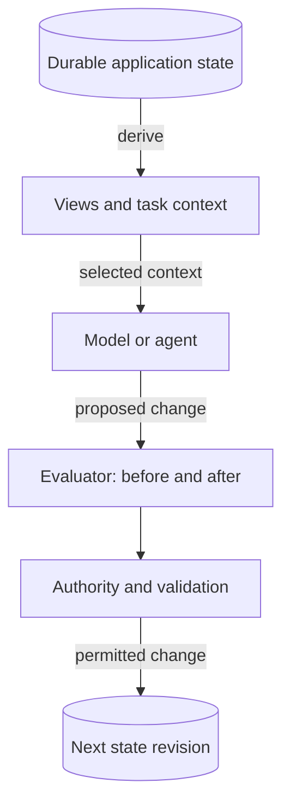
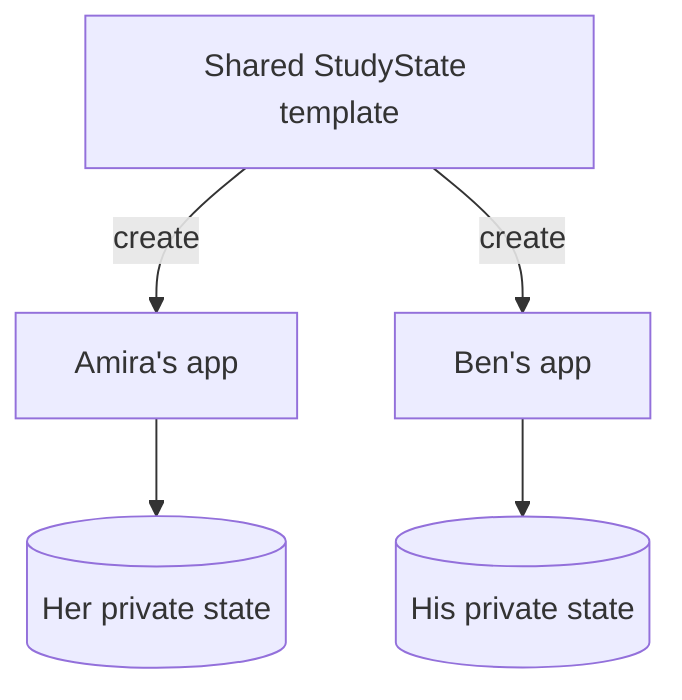
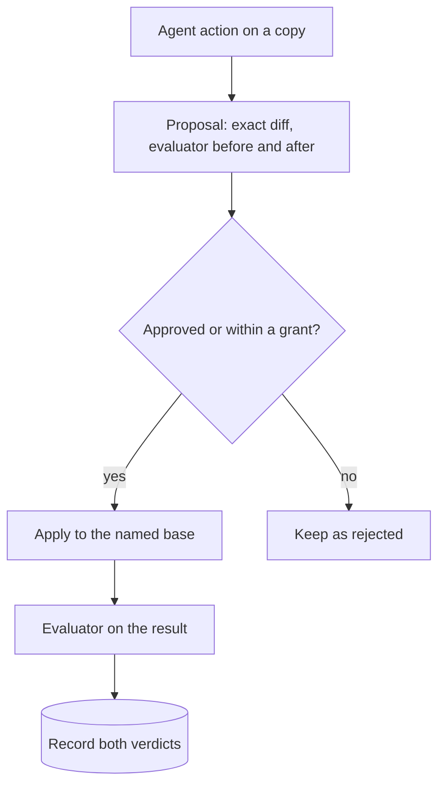
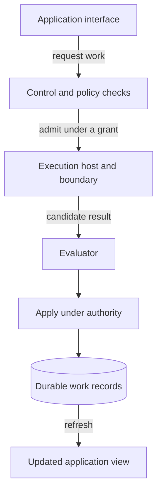
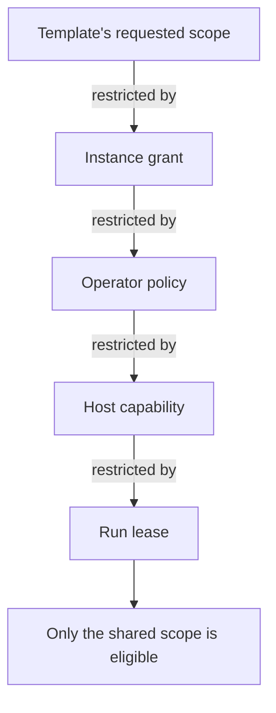
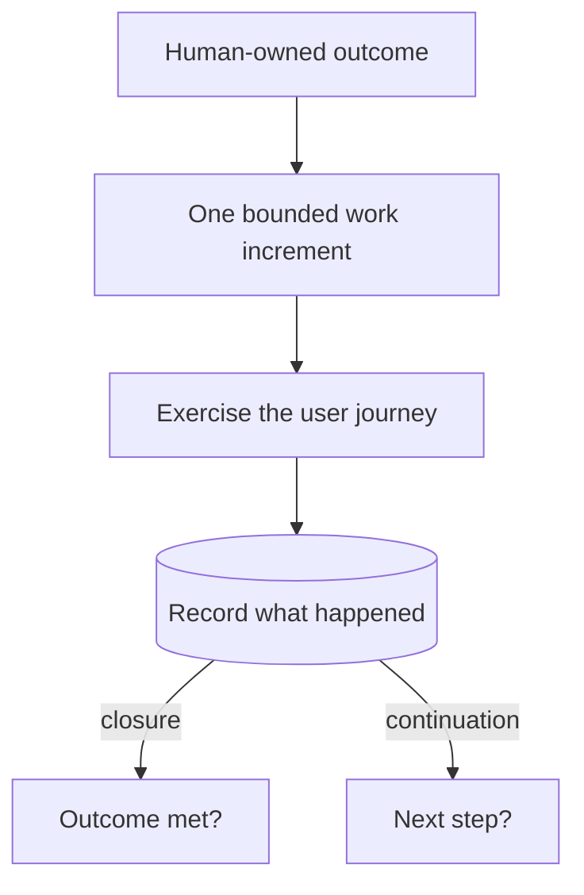
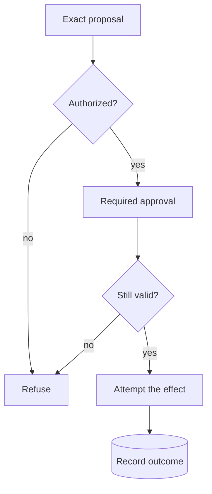
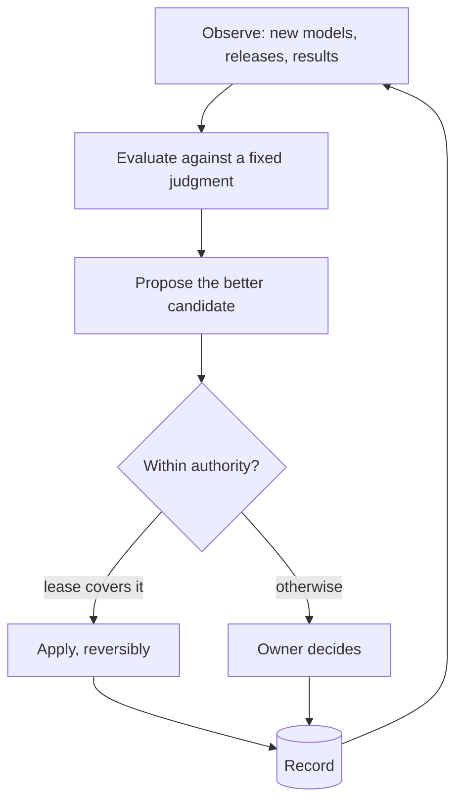
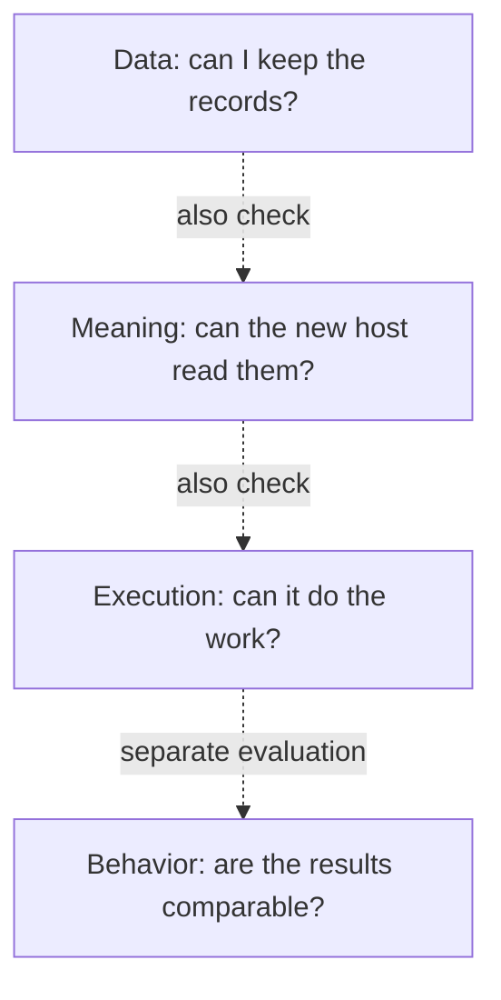

# 1. Abstract and thesis

## Abstract

AI-assisted work increasingly extends beyond a single exchange: a student follows a study plan, a developer maintains a product, a team revises a body of knowledge. The work accumulates goals, decisions, artifacts, permissions, and unresolved questions. A conversation can help produce that record, but it does not by itself establish which parts are authoritative, how another session should continue, or whether a change made the work better.

**Stateware** proposes an application boundary around durable state and the rules for changing it. The application retains its identity and useful work across sessions; interfaces present views of that work; models and agents act as replaceable instruments within explicit authority. Version 2.0 adds the part the boundary needs in order to be used, not only protected: every application declares its **outcome** and an **evaluator**, a deterministic check of its state that says whether the work is where it should be and why not. Changes are proposed against that evaluator, and authority decides which of them may apply without asking.

The evaluator also lets an application **keep up**. The instruments are on a treadmill: models, agent harnesses and templates improve every few weeks. Because state is separate from the instruments, an instrument can be replaced. Because the evaluator is declared, a replacement can be judged. Because a replacement is itself a recorded, reversible change of policy, it can be made autonomously, inside limits the owner sets. One rule keeps this safe: **no improvement loop may change its own evaluator or its own authority.**

This paper develops the model through StatePort, a platform for hosting stateful AI applications, ProjectState, a template for developing and operating projects around a human-owned outcome, and StudyState, a template for study. The central claim is architectural: **the durable identity of an AI application should reside in its state, its contracts and its evaluator, rather than in the session or engine currently acting on them.** This does not make model behavior deterministic, make every operation reversible, or establish that every implementation satisfies the model. It creates boundaries against which those properties can be examined.

## Scope

This is an architectural whitepaper, not a product manual or a comparative evaluation. "Should" and "must" describe requirements of the proposed model; they do not certify any StatePort code path. StatePort is an evolving reference implementation. What a released version has actually been measured to do is stated only on the [release page](../releases/), never here.

## A concrete example

Consider a study application. Its durable state includes the learner's objectives, agreed plan, completed exercises, reflections, and open questions. Its evaluator can say, without a model, that two reviews are overdue and that next week's plan is missing. An AI session proposes a revised plan as an exact change to the plan file. The application shows the change and what the evaluator says before and after it; the learner approves; the application records the accepted revision; the next session starts from that result. The conversation remains useful history, but a passing remark does not silently replace an agreed objective.

A month later a better model appears. The application tries it on a fixed set of practice tasks that the learner's data never leaves, finds that it plans as well and costs less, and switches, telling the learner what changed and how to switch back. The learner's plan, history and decisions are untouched by the switch.

The same pattern applies to software development: an agent can change a program without changing what the owner asked the program to achieve, and a better agent can take over the next increment without inheriting the authority of the last one. Keeping those kinds of change distinct is one of the model's most consequential decisions.

Five names recur below. **Stateware** is the architectural idea. **StatePort** is the host for applications built around that idea. **ProjectState** supplies a template for project work; **StudyState** supplies one for study. An **instance** is the particular project or learner's working application, with its own state.

# 2. Why the boundary matters

The problem is not conversation itself. Chat is an effective interface, and systems can combine it with durable storage, versioning, and tool controls. The problem arises when the conversation becomes the implicit authority for work that needs a longer life.

Five questions reveal that boundary:

- **Continuity:** after a session ends, where are the current goal, decisions, and unfinished work?
- **Authority:** which record decides what may change, and who may revise that rule?
- **Evidence:** what distinguishes an intended action, an attempted action, and a checked result?
- **Quality:** what, other than the agent's own report, says whether a change made the work better?
- **Independence:** what survives a change of model, interface, or hosting arrangement, and can the work benefit from a better one?

Adding more context does not answer these questions on its own. A larger transcript can retain contradictory decisions more faithfully without resolving which one governs. A summary can reduce reading cost while silently discarding a constraint. A memory index can retrieve relevant material without being qualified to decide its authority. A model asked to grade its own work answers a different question from the one the owner asked.

Stateware therefore separates the **record of work**, the **judgment of work** and the **instruments of work**. The record must remain available when an instrument changes. The judgment must not belong to the instrument being judged. An instrument must not acquire authority merely because it can read, summarize or improve the record.

This is an application of familiar software principles—explicit state, separation of concerns, versioned interfaces, least privilege, tests that the code under test cannot edit—to a setting in which a processor interprets natural language and can propose open-ended actions.

# 3. The application model

An application is five things: its **state**, its **outcome**, its **evaluator**, its **actions**, and the **grants** under which they run.

| Part | Owned by | Meaning |
| --- | --- | --- |
| State | the instance owner | The record the application treats as authoritative: files, history, decisions, and the durable log of what was asked and done |
| Outcome | the instance owner | What the work is for, in the owner's words |
| Evaluator | the template author | A deterministic check of the state against the outcome's structure: pass, not yet, or invalid, with reasons |
| Actions | the template author | Named units of work: checks, and changes an agent proposes |
| Grants | the instance owner | What may run, with which instruments, within which budget and time, and which changes may apply without asking |

## 3.1 Durable state and derived views

**Canonical state** means the record the application treats as authoritative: the accepted plan, current artifact, granted permission, or recorded result. It need not be one file or database. The rule is that each fact has a clear home. If a dashboard disagrees with the accepted plan, the application knows which record to trust.

A conversation view, dashboard, search index, preview, and model context are projections of that state. They can be optimized for different purposes without creating competing versions of the truth. A projection should identify its inputs and, where relevant, their revision or freshness.

This distinction does not make all operational data disposable. Original messages, user uploads, approval decisions, execution journals, and external identifiers may contain facts that exist nowhere else. They are part of the durable record, stored with the instance and backed up with it. A rendered conversation can be rebuilt; an unrecorded user decision cannot. There is one durable record per instance, not a separate truth for state, another for receipts and a third for the conversation.

**Context** is the material selected for a particular model task. For a study-plan revision, that might be the current plan, recent exercise results, and the learner's available time. It need not include every past conversation. When the task needs missing evidence, the engine should retrieve or request it through the permitted interface. What happens to remain in a model session does not become authoritative by default. The context compiled for one task is disposable; StatePort calls it a **context pack** and records what it contained and why.

## 3.2 Definition and instance

An **application definition**, supplied by a template, describes reusable behavior, state structure, views, the evaluator, actions, and requested capabilities. An **instance** is one owner's working application created from that definition. Two learners can use the same study template while keeping separate plans, histories, settings, and permissions.

The template author owns the reusable definition, including the evaluator. The instance owner owns their working content, their outcome and their decisions. StatePort owns the mechanics by which a source is resolved, materialized, registered, inspected, and operated. Consuming or adapting a template does not transfer authorship of its content to the platform.

This separation makes updates intelligible. A new template release may change a workflow or tighten the evaluator; it must not silently replace a learner's progress or a project's accepted scope. Ownership and provenance determine which material can be replaced, which must be preserved, and which needs an explicit migration or conflict decision.

## 3.3 Outcome and evaluator

An outcome says what the work is for: "a stranger installs the product with one command and it works", "pass the AI-103 exam in June". It is the owner's, in the owner's words, and no agent edits it.

An **evaluator** is a deterministic program that reads the state and returns one of three verdicts—**pass**, **not yet**, or **invalid**—with the reasons. It does not ask a model. It does not execute the user journey or certify that a claim is true. It checks what can be checked mechanically: that the recorded state is consistent, that required evidence exists for a claimed result, that a plan covers the next week, that overdue items are named. ProjectState's outcome checker is an evaluator in this sense: a passing secondary check cannot turn a failed or unrun primary journey green.

An evaluator is valuable because it is cheap, repeatable and outside the instrument. It lets a change be judged before it is applied, lets two instruments be compared on the same task, and lets an unattended run stop when the state gets worse. It is limited for the same reason: it can only see what it checks. The owner's judgment remains the final verdict on the outcome; the evaluator narrows what the owner must look at.

Evaluators can be wrong, incomplete or gamed. Section 7.4 treats that risk directly. The minimum rule is structural: an evaluator belongs to a different party from the instrument it judges, and the instrument cannot edit it.

## 3.4 Actions and proposals

An **action** is a named unit of work the template declares. There are two kinds.

- A **check** reads the state and reports. The evaluator is a check; a template may declare others ("list overdue reviews").
- An **agent action** asks an instrument—a model with tools—to work on a copy of the state toward a stated purpose ("do the next action in `STATE.yaml`", "plan the next study session"). Its result is a **proposal**: the exact change against a named base revision, the evaluator's verdict before and after, the instrument that produced it and the context it was given.

A proposal is not a change. Applying it is a separate, recorded step: it binds to the proposal's digest and base, refuses if either has moved, applies the change, runs the evaluator again on the result, and records both verdicts. The owner can approve or reject a proposal, or grant in advance that a bounded class of proposals may apply without asking (Section 6.5).

## 3.5 Contracts and adapters

StateSpec names the portable template contract used within the StatePort architecture. A contract describes the structure, evaluator, actions and capabilities a host can recognize; it is not a universal promise that any agent can run any repository. Compatibility requires agreement on schemas, action semantics, authority, and runtime prerequisites, and a contract only becomes portable when it has a conformance test that an independent host can run.

StatePort uses **adapters** to work with established formats such as ProjectState and StudyState, which predate the contract and carry no manifest of their own. An adapter recognizes the template's structure, checks that it is valid, and declares the evaluator and actions on its behalf. A new template can instead declare them itself.

A template may supply code for its checks. That code is template content, not platform code: it runs only inside the execution boundary, with no network, a read-only copy of the state, a scrubbed environment, a time limit and its own process tree, and the receipt names its exact digest. Reading a template successfully never gives its contents permission to run outside that boundary. An agent action's instructions are template text as well: they shape what the instrument is asked to do and never widen what it may do.

# 4. StatePort: hosting the lifecycle

StatePort gives the model a concrete division of responsibilities. These are logical roles, not a requirement to create a separate service for every concern.

The interface asks; the control layer checks permission; the execution host performs the work inside its boundary and returns a candidate; the evaluator judges it; the control layer applies what authority permits. The result must be recorded before a later session can reliably continue from it. A response in the interface alone is not that durable record.

| Responsibility | Architectural role | Boundary |
| --- | --- | --- |
| Application interaction | Web interface and application views | Present state, proposals and verdicts; submit requests; never receive host control sockets |
| Control | API and policy checks | Validate requests against instance identity, grants, leases and operation rules |
| Execution | Execution host, sandbox and instrument adapters | Run permitted work in the selected environment; return candidates; report effects and failures |
| Judgment | Evaluators and task suites | Check state and candidates deterministically; owned outside the instrument |
| Lifecycle | Template resolution, instance catalog, update and recovery mechanisms | Preserve source identity, ownership, instance state, and recovery boundaries |
| Context and evidence | Context preparation, approvals, receipts, and durable records | Give instruments relevant inputs and owners an inspectable account of changes |

## 4.1 Capability is an intersection

A template can request a terminal, file access, a model, or an external operation. That request describes what the application would like to do. The owner grants what the instance may use; the operator sets policy for the host; the host must be able to provide it; and a run holds a lease with its own scope and budget. An operation is eligible only where all of them agree:

> **effective authority = template request ∩ instance grant ∩ operator policy ∩ host capability ∩ run lease**

On a personal machine the owner and the operator are usually the same person acting in two roles: deciding what one application may do, and deciding what the machine allows at all. Keeping the roles distinct matters as soon as one person hosts another's instance.

For example, a study template might request file access. The owner can grant access to one study folder; that does not grant access to the rest of the machine. The host must enforce that boundary when the action runs.

The execution environment supplies enforcement: restricted identities, filesystem access, network policy, and mediated interfaces where applicable. A browser must not receive the host control socket. An instrument must not reach the control interface that would approve its own proposal. A provider adapter must not turn subscription credentials into portable application state. Rootless execution and least privilege reduce exposure, but their presence is not proof that isolation is complete.

Useful interfaces make this distinction visible. "Declared," "available," "authorized," and "successfully executed" describe different facts. A visible control or a selected provider cannot establish the last of them.

## 4.2 Durable orchestration

Longer work needs more than a request and a response. The system must know what was admitted, what began, what remains outstanding, and what evidence supports its current status. After interruption, it must recover from durable records rather than from an agent's recollection.

Cancellation illustrates the requirement. A cancellation request is an intention; a stopped process is an observation; preserved results and reconciled external effects are further facts. The interface should not collapse them into a single reassuring label.

Recovery has an ownership boundary too. Discovering a container or directory does not establish permission to delete it. A host must distinguish resources it can attribute to the recovering instance from resources whose ownership is unknown. Uncertainty should lead to retention and an explicit recovery decision, not speculative cleanup.

## 4.3 One instance, multiple instruments

An execution host can provide tools, sessions, context handling, and provider-specific behavior without becoming the authority for the instance's goals or private state. Replacing that host should preserve the work record, while making changed capabilities and prerequisites explicit.

Interchangeability is therefore conditional. Two instruments may honor the same input contract and still differ in reasoning quality, tool behavior, authentication, latency, cost, data handling, or failure modes. Stateware aims to make replacement possible, inspectable and *measurable*; it does not promise equivalent outputs. Section 7 describes how measurement turns replaceability into an advantage.

# 5. ProjectState: developing and operating projects

ProjectState applies the same concern for durable authority to developing and operating a project. The template provides the reusable structure; an instance holds the actual project and its ongoing work. Its v6 core is intentionally small: a human-owned outcome, one current slice of work, one representative user journey, and evidence of what actually happened.

| Canonical artifact | Responsibility |
| --- | --- |
| `PROJECT.md` | The user, outcome, scope, non-goals, and durable constraints owned by the human |
| `STATE.yaml` | One current slice, its acceptance criteria, primary journey, blockers, risks, and exact next action |
| `AGENTS.md` | Authority boundaries, working rules, and conditions for stopping and closure |
| `evidence/<slice-id>/summary.md` | Commands, environment, observed results, artifacts, and unresolved limitations |

The generated core also includes the outcome checker and a README. Those six files do not represent six competing sources of current truth. The README explains the product; the checker examines recorded consistency. Backlogs, architecture decisions, release records, and additional controls are optional supporting material when the project needs them.

In Stateware terms, `PROJECT.md` holds the outcome, the outcome checker is the evaluator, and `STATE.yaml`'s next action is the natural agent action: an instrument works on a copy of the project toward the recorded next step and returns a proposal that the checker judges before the owner sees it.

## 5.1 Outcome before administrative completion

A slice is a bounded increment toward the product outcome. Its primary journey is the smallest representative interaction that can show whether that increment works for the intended user. It is exercised early, then repeated when a relevant change invalidates its evidence.

This ordering prevents a common substitution: proving that code compiles or that a repository is orderly while leaving the user journey untested. Secondary checks can uncover additional blockers. They cannot reverse a failed, blocked, or unrun primary journey. If installation is part of the outcome, source-tree tests do not substitute for exercising the distributed artifact in the intended clean environment.

The outcome checker reads the recorded contract and evidence. It does not execute the journey, authenticate a human's approval, or establish that an assertion is true merely because the assertion is well formed. Its result is a consistency judgment over evidence, not an independent observation of the product.

The vocabulary follows that boundary: **implemented** means a change exists; **validated** means the named journey passed in the named environment; **published** requires separate delivery evidence; **accepted** requires the human's verdict.

## 5.2 Continuing is a separate decision

Closure asks whether the recorded outcome is satisfied. Continuation asks whether another unit of work is justified. A successful check does not, by itself, authorize more work.

ProjectState's continuation rule asks the agent to identify the unchanged outcome or safety boundary being addressed, the information or behavior expected from the next action, and why that action is the smallest sufficient step. Repeated attempts need a changed premise. After two evidenced failures at the same delivery boundary, the method calls for an assumption review and simplification before further expansion.

These rules are advisory unless an actual runner enforces admission. Writing a deadline in a file is not the same as preventing work after it. In the model, leases (Section 6.5) are that runner: a budget, an expiry and the two-failure rule must become conditions the host enforces rather than text the agent is asked to respect.

## 5.3 Development and operating use

A ProjectState instance can support both the development of a product and the ongoing operation of a project. In development use, it organizes the work of creating and improving something: the intended outcome, the current increment, the decisions made, and the evidence that the result works. StatePort itself was developed using a ProjectState instance.

In operating use, the instance remains the working home of the project: maintaining its goals, planning and carrying out work, reviewing results, and deciding what comes next. Just as a StudyState instance supports a learner's ongoing study, a ProjectState instance supports ongoing project work, with continuity across sessions and agents.

# 6. Change, authority, and evidence

## 6.1 From intent to a recorded result

A governed change has distinguishable stages: proposal, judgment, authority check, approval where required, validation, application, and recording. The proposal describes the intended effect. The evaluator judges what it would do to the state. Authority determines whether that effect is permitted. Validation checks relevant preconditions and invariants. Execution attempts the effect. The record preserves what was observed.

Approval should bind to the action and state actually reviewed. If the proposal changes, a grant expires, or relevant state has moved, the system must determine whether approval still applies before execution. Otherwise, an exact-looking approval interface can authorize something the owner never saw.

## 6.2 Agents can act, but not define their own authority

"The agent proposes, the system applies" describes the boundary around protected state. It is not a claim that an agent never executes a tool or writes in a workspace. Coding agents do both. The engineering requirement is that their effective access is bounded independently of their instructions and that promotion into protected state follows the applicable controls.

A prompt asking an agent to behave is not an authorization mechanism. Repository text and retrieved content are inputs to interpret, not permissions to widen access. The component that enforces a grant must not accept an agent's assertion that the grant has changed as sufficient evidence of that change.

## 6.3 Receipts have a scope of trust

A receipt records an operation: its identity, relevant inputs, authority, observed transitions, checks, verdicts and result. It helps distinguish an attempt from a completed effect and a checked effect from human acceptance.

A receipt is still produced by software. Its value depends on the recorder's integrity, the evidence it references, and the coverage of the checks. A signature can establish origin and integrity relative to a trusted key; it cannot establish that an answer is correct or that a test was adequate. Receipts support scrutiny rather than eliminating the need for it.

For external effects, recording and execution may fail separately. If a remote service accepts a request just before the connection drops, the local system cannot yet tell whether it succeeded. The outcome is **uncertain**, not necessarily failed. Recovery may use a request identifier that prevents duplicates, query the remote service, or require human investigation. Retrying blindly can repeat the effect.

## 6.4 Local transactions do not make the world transactional

A validated file change can often be applied atomically within a suitable storage boundary. Sending a message, spending money, or changing remote infrastructure may not be reversible. A local rollback does not undo an external event. Failing closed means refusing new effects when required authority or preconditions cannot be established; it does not mean pretending that an already attempted effect never happened.

## 6.5 Autonomy is a lease

Oversight is a property of each action, not a label on the application. The same instance can let routine, reversible work proceed while the owner watches, stop at an approval for a consequential change, and refuse an external effect outright. One table decides it, from each action's reversibility and reach:

| Effect of the action | Default |
| --- | --- |
| Reads state, changes nothing | runs when asked |
| Proposes a change to instance files | runs when asked; applying asks |
| Applies a reversible instance-local change the evaluator does not judge worse | may apply without asking inside a lease |
| Sends data outside the machine (for example to a model provider) | asks once per destination, naming what leaves and on what terms |
| Destructive, external, financial, or changes authority | asks every time; never inside a lease |

Unattended work runs only inside a **lease**: an owner grant with a holder, a scope (which actions, which instances), an instrument, a budget, an expiry, and an auto-apply scope from the table's third row. The host, not the run, must enforce it: a lease stops at its budget or expiry, halts after two evidenced failures at one boundary, parks and notifies when it needs a decision outside its scope, and stops at once when the owner pauses or revokes it, without the run's cooperation. A lease never extends itself. Which of these conditions a released version enforces, and for which actions, belongs in that version's [release notes](../download/technical-release-files.html); this paper does not claim it for any version.

Work applied under a lease is *applied*, never *accepted*. Acceptance stays a human act.

# 7. Applications that keep up

## 7.1 The instruments are on a treadmill

The value of a durable application accumulates slowly: months of plan, decisions and evidence. The value of its instruments changes quickly: a model released in spring is surpassed by summer; agent harnesses gain tools; templates tighten their evaluators. An application whose identity lived in a session would lose its record at every change of instrument. A Stateware application loses nothing, and so it can afford to change instruments often.

Changing often is only an advantage if each change is judged. Without judgment, "use the newest model" is a guess, and an application that follows every guess drifts. Stateware supplies the three parts that turn the treadmill into progress: state separate from instruments, an evaluator outside the instrument, and changes of policy that are recorded and reversible.

## 7.2 One loop, three levels

Improvement is one loop: **observe** what has changed in the world, **evaluate** candidates against a fixed judgment, **propose** the better candidate, **apply** it where authority allows, **record** the result. The loop runs at three levels that differ only in what changes and who judges it.

| Level | What changes | Judged by | How it applies |
| --- | --- | --- | --- |
| Instruments | which model and harness run which kind of action, with which settings | a frozen task suite per kind of action, graded by deterministic checks | automatically inside an owner lease, reversibly; otherwise as a proposal |
| Definition | the template: a new release, better action instructions, a stricter evaluator | the template author's tests, then the instance's own evaluator before and after | always as a proposal to the owner |
| Platform | the host itself | the platform's primary journey on a clean target machine | only as a signed successor release that passed that journey; the owner accepts |

At the instrument level the loop can run unattended, because its changes are cheap to reverse and its judgment is mechanical. At the definition level it needs the owner, because a template change can alter what the work means. At the platform level it needs the release path, because a platform change alters every application at once.

## 7.3 The fixed-point law

A system that improves itself must not improve its way out of its own constraints. One law covers all three levels:

> **No loop may change its own evaluator, its own held-out tasks, or its own authority.**

Each judgment is owned one level up: instrument suites by the platform, template evaluators by the template author, the platform's journey by its owner. Authority only narrows: a loop can be granted less, never grant itself more, and removing a policy narrows to the safe default rather than widening. A loop that misses its own declared measure over its declared window parks itself and records why; only the owner resumes or retires it.

The law lets a platform author its own successors without modifying itself. An agent may write a candidate improvement to StatePort, exactly as a human contributor may. The candidate does not touch the running platform. It ships, if at all, as a separate signed release that has passed the same clean-machine journey any release must pass, and the owner's acceptance remains the last step.

## 7.4 Measuring before trusting

An evaluator compresses a judgment, and anything compressed can be gamed. Four practices keep the loop honest.

- **Frozen and held out.** An instrument is compared on a fixed suite whose tasks it has not seen during tuning, with a small held-out part that rotates after each promotion. Each result records which suite version it used.
- **Beat the incumbent, not a threshold.** A candidate replaces the current instrument only by doing at least as well on every critical check and better overall, on the same suite. A critical failure cannot be offset by a higher score elsewhere.
- **Different judge, different party.** The verifier of a result is not the instrument that produced it, and where a model must judge, it comes from a different family than the one judged.
- **Gains must keep predicting acceptance.** If promoted instruments stop producing proposals that owners accept, the loop is optimizing the wrong thing; it parks rather than continuing.

Measurement is also a privacy question. Instrument suites use synthetic or consented tasks, never an owner's private state without a named consent.

## 7.5 The record of work is a model of the work

Every run leaves a receipt: the action, the instrument, the context it received, the verdicts, the cost and the outcome. Together they are a dataset of how this owner's work responds to which instruments. The first use is plain: a table of pass rates and costs per kind of action and instrument, with sample counts, consulted before choosing an instrument and before admitting expensive work. A predictive model trained on the same record—whether a simple calibrated predictor or a learned representation of the work—can replace the table later under the same rule as everything else: it may rank options and decline to start hopeless work; it may never widen authority or admit what policy refuses.

## 7.6 What keeping up does not mean

Keeping up does not mean following every release, routing through accounts the owner has not connected, or sending private state to a new provider because it scored well. A new provider is a new destination and asks first (Section 6.5). Keeping up also does not make outcomes certain: a better instrument on a suite is evidence about the suite, not a promise about the owner's next task. The loop narrows the gap between what the field can do and what the application uses; it does not close the question of whether the work is good. That question stays with the evaluator and, finally, with the owner.

# 8. Lifecycle, portability, and recovery

The lifecycle is the application's life over time: install a definition, create an instance, use it, review what happened, update it, back it up, and recover when needed. Throughout that life, the platform must distinguish template content from the owner's private work, permissions, and disposable generated views.

## 8.1 Install and update

Installation selects and verifies an identified source, creates the instance from it, and records where that content came from. A mutable discovery label can help someone find a release; the installed instance still needs an exact identity. The template requests capabilities, and the owner and operator determine the effective grant.

An update compares the new definition with the instance's existing content and the rules for who owns each part. Conflicts, schema changes, altered evaluators and altered capability requests are decisions to expose. Updating the platform, updating a template, and migrating private instance data are related but distinct operations; one successful package replacement does not prove all three succeeded. A platform that intends to change itself often must make each successor readable by the next and its data compatible across them; without that, improvement becomes a risk to the record it exists to serve.

## 8.2 Portability has several layers

**Data portability** preserves readable state and artifacts. **Semantic portability** preserves their meaning across schema and contract versions. **Execution portability** requires a compatible host, tools, dependencies, and credentials. **Behavioral equivalence** would require comparable outcomes from different instruments and is a stronger claim still.

The first layer does not imply the others. Copying a directory may preserve useful work while leaving an external integration unavailable. A destination may need new grants because permissions are local to its operator and environment. Credentials should be provisioned through supported authentication paths, not silently copied into a portable bundle.

## 8.3 Backup is a consistency problem

A useful backup includes every authoritative record required to recover the instance, at a mutually consistent point: files, the conversation log, receipts, manifests and ownership metadata. A copy made during active mutation is not automatically such a snapshot.

Recovery must verify the backup, restore compatible state, re-establish identity and permissions, and reconcile interrupted work. Disposable projections can then be rebuilt. A restore rehearsal is stronger evidence of recoverability than the existence of an archive. Durability remains an engineering property to test.

# 9. Tradeoffs and questions for evaluation

Explicit state, evaluators and governance have costs. Data formats evolve. Adapters need maintenance. Receipts consume storage. Context preparation can omit relevant material. Isolation can prevent useful work when its permissions are too narrow. Excessive confirmations can train people to approve without reading. Evaluators can be narrow, and a loop that optimizes a narrow evaluator can make work worse in ways the evaluator does not see.

The design response is proportionality. Keep canonical records small enough to understand, preserve detailed evidence where needed, and add controls for a concrete consequence. Routine safe work should fit within leases. Additional services, ledgers, and mandatory process artifacts should earn their cost by resolving a real uncertainty—for the user, not only for an auditor.

Local ownership does not imply zero disclosure. When an external provider processes selected context, that context crosses a trust boundary. Free model offers are a concrete case: some providers state that data sent during a model's free period may be used to improve that model. A Stateware application names the destination and those terms before the first request and records the owner's choice.

The model can be evaluated through concrete questions:

- Can a new session, on a different instrument, resume the actual work from state alone?
- Does an agent action on a fresh installation produce a proposal the owner finds useful, and does applying it survive a restart?
- Does the evaluator's verdict before and after a proposal agree with the owner's judgment of it?
- Can an owner distinguish authoritative state from a stale or incomplete projection?
- Does a denied operation leave protected resources unchanged, and does an uncertain external effect remain visible?
- Can a template update preserve private content and expose conflicts before applying them?
- Can a backup restore a usable instance, including interrupted-work reconciliation?
- When a better instrument appears, does the loop find it, switch reversibly, and leave the record untouched?
- Does the full system deliver useful work within the target machine's resources, with acceptable effort from its owner?

These questions require observable journeys, interruption tests, and measurements. A feature inventory or a collection of passing component tests cannot answer them alone. This paper makes no measured claim.

Open design questions include concurrent writers, migration between contract versions, evidence retention under erasure requests, evaluators for outcomes that resist mechanical checks, and how to explain a meaningful approval without overwhelming its reader. A shared ecosystem would also need conformance tests across independent hosts. A named specification alone does not establish interoperability.

# 10. The bet

The value of an AI application accumulates in the work it helps someone carry forward: a clearer plan, a maintained system, a body of knowledge, a sequence of decisions they can still understand. That value should not have to be reconstructed whenever a session ends or an instrument changes.

Stateware places durable state, explicit contracts and a declared evaluator at that boundary. The state keeps the work; the evaluator says what better means; authority decides what may change without asking. With those three in place, the speed of the field stops being a threat to the work and becomes something the work can use: better instruments can be tried, judged and adopted, by the application itself, without touching what the owner has built or what the owner has allowed.

**State is the application boundary.**

# Reading and provenance

This is the public edition, published on 22 October 2026. It extends version 1.1 (9 September 2026), which remains available. It keeps 1.1's argument and corrections, and adds the evaluator (Sections 3.3–3.4), the authority table and leases (Section 6.5) and the improvement loop (Section 7). The July v1.2 candidate remains a historical draft. The architectural decisions behind this edition are recorded in StatePort's ADR-0007.

The architectural account is grounded in StatePort's template adapter, persistent application, execution-host and lifecycle code, and in ProjectState's v6 core, outcome checker and release mechanism. These sources establish the design and implementation vocabulary; they do not substitute for qualification of any described behavior. Software availability and measured behavior belong on the [release page](../releases/).

## Authorship

Lennert Van Hoyweghen defines the model and its product direction. Coding agents assist with implementation, analysis, and editorial revision; this edition was drafted by the coordinating agent under the owner's delegation. Their participation does not transfer ownership of the outcome, acceptance criteria, or final product judgment from the human. The owner asked for this edition to be published, and it appeared on 22 October 2026 as the public edition; version 1.1 remains available.
